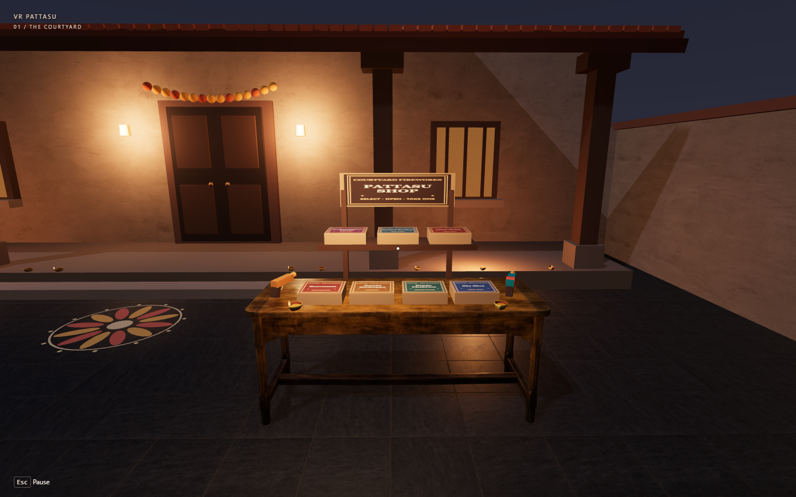

# VR Pattasu Simulator — Diwali Fireworks in Your Browser

VR Pattasu Simulator is a first-person **Diwali firecracker simulator** set in an Indian courtyard at night. Visit the fireworks stall, open boxes of pattasu (பட்டாசு, Tamil for fireworks), and light virtual sparklers, flower pots, ground spinners, and aerial fireworks with an incense stick. Play with a keyboard and mouse or mobile touch controls, or enter immersive VR through WebXR in Meta Quest Browser.

**[Play the Diwali fireworks simulator](https://vr-pattasu-simulator.netlify.app/)** · [Controls](#controls) · [Run locally](#run-locally) · [How it works](#how-it-works)



## What you can do

- Explore a nighttime courtyard with stone paving, rangoli, and clay diyas you can light.
- Open and close labeled firecracker boxes, check remaining stock, and take individual fireworks from the stall.
- Light your incense stick from a burning diya, then use it on a fuse. Hold the sparkler in hand or place ground and aerial fireworks in the open courtyard.
- Try the Single-Cap and Roll-Cap toy pistols with unlimited caps. Aim at a placed virtual firecracker to ignite it.
- Watch sparks, drifting smoke, and bursts that briefly light the courtyard, with positional audio and nighttime ambience.
- Adjust graphics quality, volume, and reduced flashes. Reset the courtyard to restock the shop.

[See an open firecracker box](VR_Pattasu_Starter_Docs/evidence/phase8-open-box.png) · [See a Sky Shot aerial burst](VR_Pattasu_Starter_Docs/evidence/skyshot-enhanced.png)

## Nine playable fireworks

| Firecracker | In-game effect |
| --- | --- |
| **Busvanam** | Flower pot fountain that sprays golden sparks |
| **Kambi Mathappu** | Handheld sparkler |
| **Sangu Chakram** | Ground spinner that traces a circle of sparks |
| **Sky Shot** | Aerial shell that rises and bursts overhead |
| **Red Cracker Chain** | A string of short, sequential bursts |
| **Comet Rocket** | Aerial rocket with a glowing trail |
| **1000 Wala** | Coiled firecracker chain with sustained sequential pops |
| **Bijili Crackers** | Short string of six quick, sharp pops |
| **Atom Bomb** | Single heavy ground burst with scattered paper |

The 1000 Wala fires in uneven clusters of pops. Paper scraps tumble onto the paving and remain there until reset or until the debris pool fills.

## Controls

### Desktop

Select **Enter courtyard** to capture the mouse.

| Input | Action |
| --- | --- |
| **W / A / S / D** and mouse | Move and look |
| **Shift** | Move faster |
| **Click / E** | Interact with a box lid or take an item from an open box |
| **G** | Place a carried ground or aerial firecracker |
| **F** | Light the incense stick at a burning diya, light another diya, or ignite a fuse in reach |
| **Click** | Fire an equipped toy cap pistol |
| **R** | Reset the courtyard and restock the stall |
| **Esc** | Release the mouse |

### Mobile touch

Use the on-screen joystick to move and drag to look around. Tap a box or its contents to target them, then follow the on-screen action prompts for pickup, placement, and ignition. Use **Fire** when a toy pistol is equipped.

### Meta Quest 3 and WebXR

1. Open the [HTTPS demo](https://vr-pattasu-simulator.netlify.app/) directly in **Meta Quest Browser** and select **Enter VR**.
2. Use the **left trigger** to teleport and the **right thumbstick** to snap turn.
3. Use the **right trigger** to open boxes, pick up fireworks, and place them. The same trigger fires an equipped toy pistol.
4. Bring the right-hand incense tip to a burning diya, then touch the glowing tip to the fuse. The handheld sparkler goes in the left hand.
5. Press **B** to reset. Use the headset's system controls to leave VR.

The Quest controller workflow was checked with WebXR emulation. Physical headset testing is pending, including comfort and performance.

### Play in Your Room (mixed reality)

On a supported headset, open the HTTPS site in Meta Quest Browser and choose **Play in Your Room** below **Enter VR**. Start facing an open area with your headset's floor level set. A virtual shop appears in front of you over the headset's passthrough view. Use the right trigger to open a box, take a firecracker, and place it on clear floor away from the counter. Light it with the virtual diya and incense stick, or use a toy cap pistol.

The mode uses the headset's tracked floor. Furniture and walls are outside its placement and occlusion model. Move and turn physically within your clear play area. Use the Quest system menu to exit.

## Run locally

Use **Node.js 24** and npm.

```bash
git clone https://github.com/sukeshperiyasamy/vr-pattasu-simulator.git
cd vr-pattasu-simulator
npm ci
npm run dev
```

Open the local URL printed by Vite. To check the project and preview the production build, run the following commands.

```bash
npm run typecheck
npm run lint
npm test
npm run build
npm run preview
```

For Netlify, deploy from `main` with the repository root as the base directory, Node.js 24, `npm run build` as the build command, and `dist` as the publish directory. The application runs on static hosting. Use HTTPS for headset access.

## How it works

| Layer | Implementation |
| --- | --- |
| Application | React, TypeScript, and Vite run the UI and build the static site |
| 3D courtyard | Three.js, React Three Fiber, and Drei render the environment, GLB props, and effects |
| Input and VR | Desktop, touch, and React Three XR controller inputs feed the same gameplay interactions |
| Shop and gameplay state | Zustand tracks box stock, held items, and the firecracker lifecycle |
| Sound and light | Howler.js plays positional cues while pooled lights illuminate nearby surfaces during fireworks |

When a player takes a firecracker, stock drops only after a gameplay item is successfully created. That item uses the same carry, placement, ignition, and effect logic regardless of input device.

Start with the [app entry](src/app), [courtyard scene](src/scene), [shop](src/shop), or [firework definitions and effects](src/fireworks). The [architecture notes](VR_Pattasu_Starter_Docs/03_TECH_STACK_AND_ARCHITECTURE.md) and [roadmap](VR_Pattasu_Starter_Docs/07_ROADMAP_AND_TASKS.md) describe the project in more detail.

## Asset credits

- **Poly Haven (CC0)** provides the granite paving, plaster, nighttime environment map, and wooden table.
- **Innerscene (CC0)** provides the clay diya model.
- **Immersive Web WebXR Input Profiles (MIT)** provides the Quest Touch Plus controller profiles.
- The stall geometry, unbranded packaging, firecracker cues, and nighttime ambience are original project assets.

See the [full credits and license notices](public/assets/licenses/credits.txt) and [asset manifest](VR_Pattasu_Starter_Docs/06_ASSET_MANIFEST.csv) for source details.
